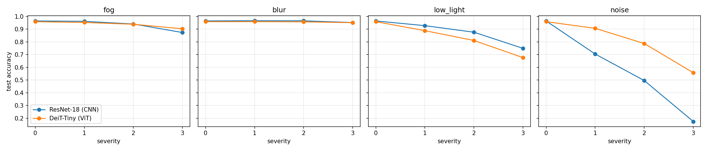
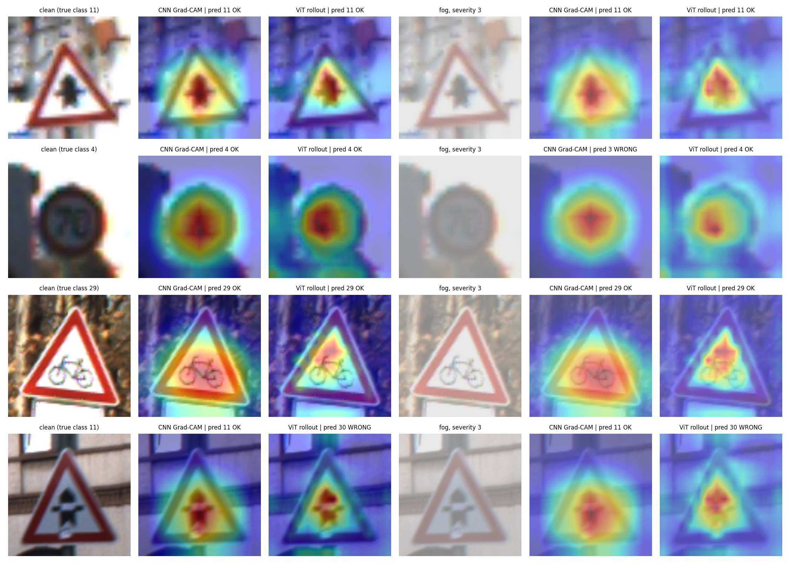
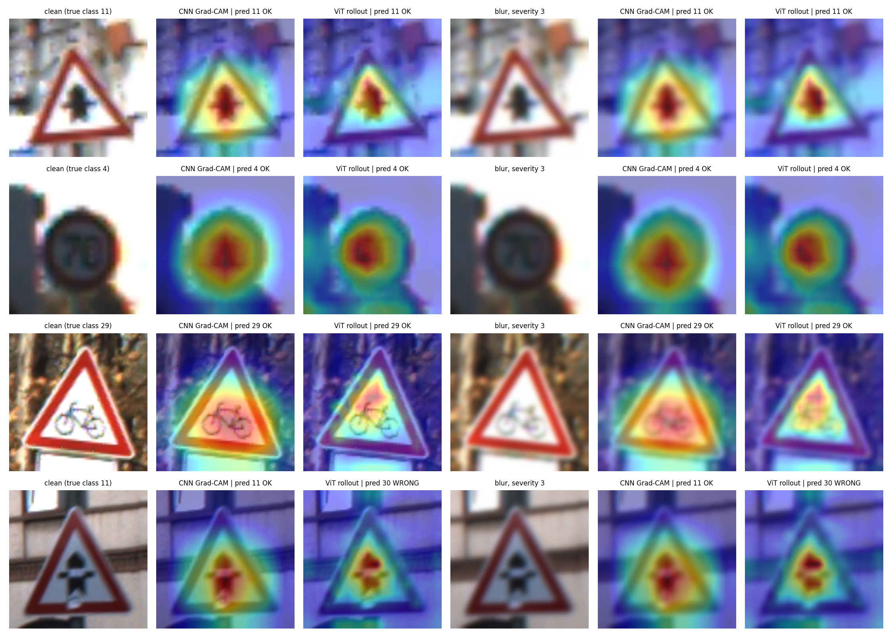

# How do vision models fail, and can we see why?
### A small ViT vs CNN robustness and explainability study on traffic signs (GTSRB)

> **Status: exploratory self-study project.** Small data subset, single random seed, simplified corruption simulations. Not a benchmark.

## Motivation
Vision models trained on clean data often degrade in poor visibility, low light or noise, and when they fail it is hard to tell why. I wanted to measure how much two model families lose under degraded conditions, and to look at *where* each model focuses when it succeeds or fails.

## Questions
1. How does accuracy change for a small Vision Transformer (DeiT-Tiny) and a CNN (ResNet-18) under simulated fog, blur, low light and noise?
2. Do Grad-CAM (CNN) and attention rollout (ViT) show the models' focus shifting away from the sign under degradation?
3. Do those explanations pass a simple faithfulness check (deletion test)?
4. How do the models compare in size and latency?

## Method
- **Data:** random subset of GTSRB (6,000 train / 2,000 test images, 43 classes), resized to 224x224.
- **Models:** ImageNet-pretrained ResNet-18 (torchvision) and DeiT-Tiny (timm), fine-tuned with the same recipe (AdamW, lr 1e-4, 3 epochs).
- **Corruptions:** fog (haze blend), Gaussian blur, low light (gamma and scale), Gaussian noise, at 3 severities each. These are simple approximations, not physically exact simulations.
- **Explanations:** Grad-CAM on ResNet-18's last stage; attention rollout (Abnar & Zuidema, 2020) on DeiT-Tiny.
- **Faithfulness:** remove the top 20% most-highlighted pixels and compare the confidence drop with removing a random 20% region.
- **Efficiency:** parameters and inference latency (Colab GPU; relative comparison only).

## How to run
1. Click the Colab badge above (or upload `robustness_explainability.ipynb` to Google Colab).
2. Runtime > Change runtime type > GPU, then Runtime > Run all (about 15-25 minutes).
3. Outputs are saved in `results/` (CSV tables and PNG figures).

## Results
> **TO FILL IN after you run the notebook. Copy the real numbers from the final notebook cell. Do not estimate or round up.**

### Accuracy on clean and corrupted test images
[PASTE the accuracy table here]

### Where do the models look?

### Faithfulness (deletion test)
[PASTE the faithfulness table here]

### Size and latency
[PASTE the latency table here]

## Findings
> **WRITE THESE IN YOUR OWN WORDS (5-8 sentences each), based on your actual results:**
> - Which model was more robust to which corruption, and by how much.
> - What changed in the explanations between clean and degraded images.
> - Whether the deletion test supported the explanations.
> - The accuracy / robustness / latency trade-off.

## Limitations
- Small training and test subsets and a single seed, so differences of a few points may be noise.
- GTSRB is a relatively clean, centred, single-object dataset. Results may not transfer to real driving scenes or detection tasks.
- Corruptions are simplified simulations, not real fog, dust or sensor noise.
- Grad-CAM and attention rollout are approximate explanation methods, not ground truth about model reasoning, and they are not directly comparable across architectures.
- Latency was measured on a cloud GPU, not on edge hardware.

## What I would do next
- Repeat with several seeds and confidence intervals.
- Add adaptation methods (e.g. training with corruptions, test-time normalisation) and measure how much accuracy they recover.
- Test quantisation or token reduction for edge deployment, and evaluate on real degraded imagery.

## Use of AI assistance
I used AI tools to help draft and debug the code, then ran, modified and analysed the experiment myself. The analysis and conclusions above are my own.

## Tech stack
Python, PyTorch, torchvision, timm, pandas, matplotlib.
