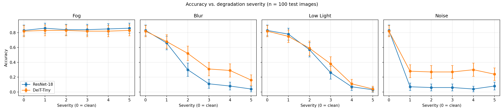
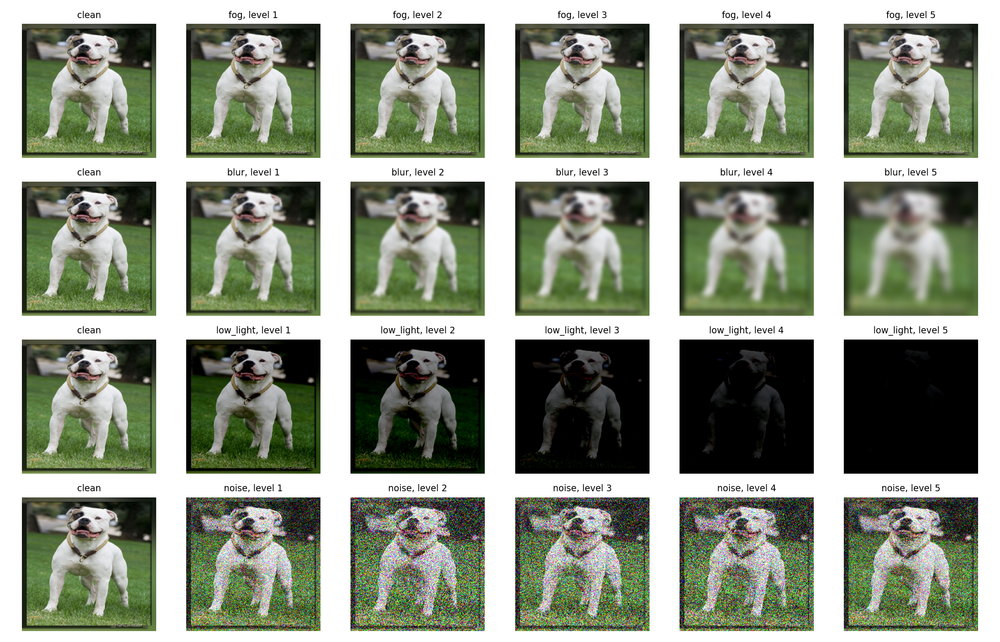

# DeiT-Tiny vs ResNet-18: robustness to image degradations

A small, beginner-friendly computer vision project in PyTorch.

**Question:** after fine-tuning a Vision Transformer (DeiT-Tiny) and a CNN (ResNet-18) on the same small dataset, how does each model's accuracy change when test images are degraded by fog, blur, low light, or noise? And how fast is each model at inference?

> **Status: preliminary results.** The numbers below come from a short "quick test" run (100 test images, one random seed, short fine-tuning). Two of the four degradations (fog and noise) did not behave as intended, as explained under "Results" and "Limitations". Treat the findings as a first look, not as a conclusion.

## What this project does

1. Downloads **Oxford-IIIT Pets** (37 cat and dog breeds).
2. Fine-tunes ImageNet-pretrained **DeiT-Tiny** and **ResNet-18** with identical settings.
3. Evaluates both on clean test images and on images degraded with **Albumentations** (fog, blur, low light, noise), 5 severity levels each.
4. Plots **accuracy vs. degradation severity**, with approximate 95% confidence intervals.
5. Measures **inference latency** (GPU and CPU, batch size 1 and 32).

## Repository layout

```
.
├── notebooks/
│   └── deit_vs_resnet_robustness.ipynb   # the whole experiment, step by step
├── docs/
│   └── how_it_works.md                   # plain-language explanation of every step and concept
├── results/
│   ├── results_accuracy.csv              # accuracy for every model / degradation / severity
│   ├── results_latency.csv               # latency measurements
│   ├── accuracy_vs_severity.png          # main figure
│   └── degradation_examples.png          # what the degraded images look like
├── requirements.txt
└── README.md
```

## Quick start (Google Colab)

1. Open `notebooks/deit_vs_resnet_robustness.ipynb` in Google Colab.
2. `Runtime -> Change runtime type -> T4 GPU`.
3. Run once with `QUICK_TEST = True` to check everything works (small and fast).
4. Set `QUICK_TEST = False` and run all cells for the full experiment.
5. Download the generated files and put them in `results/`.

To run locally instead, install the packages in `requirements.txt` (a GPU is strongly recommended).

## Experimental setup (this run)

| Item | Value |
|---|---|
| Dataset | Oxford-IIIT Pets, 37 classes |
| Train / val split | 85% / 15% of `trainval`, fixed seed |
| Evaluation images | **100** randomly chosen test images (fixed seed); the same images are used for every model and degradation |
| Models | `deit_tiny_patch16_224` (timm, 5,531,557 parameters with the 37-class head), `resnet18` (torchvision, 11,195,493 parameters with the 37-class head), both ImageNet-pretrained |
| Fine-tuning | Quick-test setting (`QUICK_TEST = True`, i.e. 1 epoch) |
| Optimizer | AdamW, same learning rate (3e-4) and weight decay (0.01) for both, not tuned |
| Schedule | cosine learning-rate decay |
| Degradations | fog, Gaussian blur, low light, Gaussian noise (Albumentations 1.x), 5 levels each, **chosen by me, not calibrated to a benchmark** |
| Seed | 42, single run |
| Hardware | Google Colab, Tesla T4 GPU |

## Results

Chance level for 37 classes is about 0.027 (2.7%).

### Accuracy on 100 test images

| Degradation | Severity | ResNet-18 | DeiT-Tiny |
|---|---|---|---|
| clean | 0 | 0.83 | 0.82 |
| fog | 1 | 0.86 | 0.83 |
| fog | 2 | 0.84 | 0.83 |
| fog | 3 | 0.84 | 0.82 |
| fog | 4 | 0.85 | 0.82 |
| fog | 5 | 0.86 | 0.83 |
| blur | 1 | 0.66 | 0.68 |
| blur | 2 | 0.30 | 0.52 |
| blur | 3 | 0.11 | 0.31 |
| blur | 4 | 0.08 | 0.29 |
| blur | 5 | 0.04 | 0.16 |
| low light | 1 | 0.78 | 0.75 |
| low light | 2 | 0.57 | 0.59 |
| low light | 3 | 0.26 | 0.38 |
| low light | 4 | 0.07 | 0.11 |
| low light | 5 | 0.03 | 0.04 |
| noise | 1 | 0.07 | 0.28 |
| noise | 2 | 0.06 | 0.27 |
| noise | 3 | 0.06 | 0.27 |
| noise | 4 | 0.04 | 0.30 |
| noise | 5 | 0.08 | 0.24 |

With only 100 images, each accuracy has an approximate 95% confidence interval of about ±0.07 to ±0.10 for values in the middle of the range (for example 0.52 ± 0.10) and narrower for values close to 0 (for example 0.04 ± 0.04). The error bars in the plot show this.



### What the degraded images look like

Rows: fog, blur, low light, noise. Columns: clean, then severity 1 to 5.



### Observations (what the data shows, and what it does not)

- **Clean images:** both models score about the same (0.83 vs 0.82). With 100 images this difference is far smaller than the error bars.
- **Blur:** both models lose accuracy steadily as blur increases. At severity 1 they are similar (0.66 vs 0.68). From severity 2 to 5, DeiT-Tiny keeps more accuracy (for example 0.52 vs 0.30 at severity 2), and the error bars do not overlap at those levels. In this run, DeiT-Tiny was clearly more tolerant of blur.
- **Low light:** both models collapse as images get darker. The gaps between models are small (for example 0.38 vs 0.26 at severity 3) and mostly within the error bars, so no clear difference can be claimed. At severity 4 and 5 the images are nearly black (see the example grid) and accuracy is close to chance for both models, so these two levels are probably too extreme to be informative.
- **Noise:** accuracy drops sharply already at severity 1 for both models (ResNet-18 from 0.83 to 0.07, DeiT-Tiny from 0.82 to 0.28), and DeiT-Tiny stays higher at every level. **However, accuracy hardly changes between severity 1 and 5, and the example images show heavy noise already at severity 1.** This means the noise "severity ladder" did not scale gradually as I intended, so the noise results effectively describe a single strong-noise condition. I have not yet found the cause (a likely suspect is how the installed Albumentations version interprets the noise-strength argument; this is not confirmed).
- **Fog:** accuracy stays within a few points of the clean accuracy for both models at every level, and the example images show almost no visible fog. In this run the fog transform barely changed the images, so **these results say nothing about fog robustness**. The small differences from clean (some values slightly above clean accuracy) are random variation.

### Inference latency (Tesla T4 GPU and CPU)

Forward pass only, random input, 32-bit floats, PyTorch eager mode. Mean and standard deviation are over repeated timed runs after warm-up (GPU: 100 runs; CPU: 20 runs). The CPU measurements used 1 thread.

| Model | Parameters | Hardware | Batch | Mean ms / batch (std) | Median ms / batch | Mean ms / image |
|---|---|---|---|---|---|---|
| ResNet-18 | 11,195,493 | Tesla T4 | 1 | 2.70 (0.32) | 2.60 | 2.70 |
| ResNet-18 | 11,195,493 | Tesla T4 | 32 | 26.80 (0.22) | 26.71 | 0.84 |
| DeiT-Tiny | 5,531,557 | Tesla T4 | 1 | 6.44 (1.92) | 6.15 | 6.44 |
| DeiT-Tiny | 5,531,557 | Tesla T4 | 32 | 33.56 (0.41) | 33.42 | 1.05 |
| ResNet-18 | 11,195,493 | CPU (1 thread) | 1 | 54.91 (2.98) | 53.40 | 54.91 |
| ResNet-18 | 11,195,493 | CPU (1 thread) | 32 | 1855.92 (239.97) | 1713.91 | 58.00 |
| DeiT-Tiny | 5,531,557 | CPU (1 thread) | 1 | 33.68 (1.73) | 33.19 | 33.68 |
| DeiT-Tiny | 5,531,557 | CPU (1 thread) | 32 | 1029.84 (167.94) | 926.65 | 32.18 |

- **On the T4 GPU**, ResNet-18 was faster in both settings: about 2.4x faster at batch size 1 (2.70 ms vs 6.44 ms) and about 1.25x faster at batch size 32 (26.80 ms vs 33.56 ms per batch), even though it has about twice as many parameters.
- **On the single-thread CPU**, DeiT-Tiny was faster: about 1.6x at batch size 1 (33.68 ms vs 54.91 ms) and about 1.8x per image at batch size 32 (32.18 ms vs 58.00 ms).
- The DeiT-Tiny GPU batch-1 timing is noisy (standard deviation 1.92 ms on a mean of 6.44 ms), and the CPU batch-32 timings vary a lot between runs, so treat those numbers as approximate.
- I have not investigated why the ranking flips between GPU and CPU. A parameter count alone does not determine speed; it depends on the operations used and how well the hardware runs them.

## Limitations (please read)

- **Quick-test run.** Only 100 test images, one random seed, and short fine-tuning. Small differences may be noise, and I have not repeated the run with other seeds.
- **Fog and noise did not work as intended** (see the observations above), so conclusions are limited to blur and low light.
- **Low-light severities 4 and 5 are nearly black**, so accuracy at those levels is close to chance for both models.
- The two models differ in size and architecture, so differences cannot be attributed purely to "transformer vs CNN".
- Degradation severities are my own choices, and the degradations are synthetic. For a standardized benchmark see ImageNet-C.
- Models are fine-tuned on clean images only and are not adapted to the degradations.
- Latency covers the model forward pass only (random input, 32-bit floats), not data loading or preprocessing, and depends on the hardware and CPU thread count.

## Next steps

1. Re-run with `QUICK_TEST = False` (more epochs and 500 evaluation images, or the full test set) and update the tables.
2. Fix the fog and noise settings and check that the severity levels look gradual in `degradation_examples.png` and in the measured change in pixel values.
3. Soften low-light levels 4 and 5.
4. Repeat with 3 or more seeds and report mean and standard deviation.
5. Further ideas: more degradations (JPEG, rain, motion blur), training with degraded images as augmentation, larger models, an accuracy-vs-latency trade-off plot, per-class error analysis.

For a step-by-step explanation written for beginners, read [`docs/how_it_works.md`](docs/how_it_works.md).

## References

- Touvron et al., *Training data-efficient image transformers & distillation through attention* (DeiT), 2021.
- Dosovitskiy et al., *An Image is Worth 16x16 Words* (Vision Transformer), 2020.
- He et al., *Deep Residual Learning for Image Recognition* (ResNet), 2016.
- Hendrycks and Dietterich, *Benchmarking Neural Network Robustness to Common Corruptions and Perturbations* (ImageNet-C), 2019.
- Parkhi et al., *Cats and Dogs* (Oxford-IIIT Pets), 2012.
- Buslaev et al., *Albumentations: fast and flexible image augmentations*, 2020.
- PyTorch Image Models (`timm`) by Ross Wightman.
